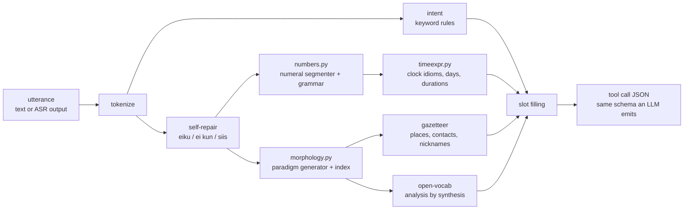

# Tulkki: Finnish language understanding for voice assistants

**Tulkki** (Finnish for *interpreter*) turns spoken Finnish requests into structured tool calls. It handles the parts of Finnish that break assistants built for English: 15 grammatical cases, consonant gradation, compound numerals, the gap between written and spoken Finnish (*kirjakieli* vs *puhekieli*), and speech-recogniser noise. It comes with a benchmark for scoring rule-based, LLM and hybrid systems on the same task.

```text
$ tulkki parse "Herätä mut huomenna puol kasilta"
{"name": "set_alarm", "args": {"time": "07:30", "day": "tomorrow"}}

$ tulkki parse "Tekstaa Hennal et ostatko maitoo"
{"name": "send_message", "args": {"contact": "Henna Virtanen", "text": "ostatko maitoo"}}

$ tulkki parse "Navigoi Turkuun, ei kun Saloon"
{"name": "navigate", "args": {"destination": "Salo"}}
```

No runtime dependencies, about 0.03 ms per utterance in pure Python, 86 tests.

---

## Why Finnish is hard for assistants

A pipeline built for English assumes three things: names appear in their dictionary form, numbers are separate words, and people speak the way they write. Finnish breaks all three.

| Phenomenon | What the user says | What the assistant must output |
|---|---|---|
| Case endings on names | *Soita **Mikolle*** | `contact: Mikko` |
| Consonant gradation | *Sää **Lahdessa*** / *Navigoi **Lahteen*** | `location: Lahti` |
| Ablative numerals mean "at" | *Herätä minut **kahdeltatoista*** | `time: 12:00` |
| Clock idioms | ***puoli** kahdeksan* = 7:30, *varttia **vaille** viisi* = 4:45 | `time` |
| Colloquial numerals | *kakskytviis*, *kasilta*, *seiskalt*, *yheltätoist* | 25, 8:00, 7:00, 11:00 |
| Colloquial case forms | *Helsingi**s***, *Tamperee**l***, *Kamppi**i*** | `Helsinki`, `Tampere`, `Kamppi` |
| Slang and nicknames | *pirauta **mutsille***, *sataaks **Stadis*** | `äiti`, `Helsinki` |
| ASR splits compounds | *kaks kymmentä viis minuuttia* | `seconds: 1500` |
| Self-repair | *herätä kymmeneltä, **ei kun** yhdeksältä* | `time: 09:00` |

The **naive baseline** below is the same intent classifier with English-style slot filling: a digit regex and a lookup of names in their dictionary form. It gets the intent right 100% of the time, but the whole tool call right only 3% of the time. Every bit of the difference comes from morphology.

## Results

The benchmark scores **exact match** (EM), meaning the whole tool call is correct: right tool, right arguments, nothing extra. That is what the user experiences. Results are split by register, because an aggregate number hides the failures a market owner cares about.

**Fresh test set** (`data/test2.jsonl`, n = 68, written after the system was frozen; see the protocol below):

| system | standard | colloquial | ASR-style | **overall EM** | intent acc | slot F1 |
|---|---|---|---|---|---|---|
| naive baseline (English-style slots) | 0.0% | 0.0% | 15.4% | **2.9%** | 100% | 30.9% |
| Tulkki − name inflection | 50.0% | 56.0% | 53.8% | **52.9%** | 100% | 75.2% |
| Tulkki − colloquial forms | 90.0% | 76.0% | 100% | **86.8%** | 100% | 93.2% |
| Tulkki − open-vocab & self-repair | 73.3% | 96.0% | 100% | **86.8%** | 100% | 92.7% |
| **Tulkki (full)** | 90.0% | 96.0% | 100% | **94.1%** | 100% | 96.1% |

Every component earns its place. Name inflection is worth about 40 points of EM. Colloquial forms are worth 20 points on colloquial speech. Open-vocabulary lemmatisation and self-repair are worth 17 points on standard speech. Run `tulkki bench` to reproduce all tables, including the other datasets (`results/benchmark.md`).

### Evaluation protocol

Rule systems overfit easily to the sentences their author has in mind, so development and evaluation were kept apart:

1. **`dev.jsonl`** (121 hand-written utterances) and **`synthetic.jsonl`** (3,000 generated utterances) were used during development. Scores on these are 100% by construction, and they act as regression tests.
2. **`heldout.jsonl`** (85 utterances) was written with the system **frozen at v1**. v1 scored **87.1% EM** on it (`results/heldout_v1_frozen.json`).
3. The v1 errors were analysed (below) and fixed, which gave v2. One annotation error was corrected (*Satul* → *Sadul*). The held-out set is now contaminated, so its v2 score is not reported as a result.
4. **`test2.jsonl`** (68 utterances) was written with **v2 frozen**, and evaluated once: **94.1% EM** (`results/test2_v2_frozen.json`).

### Error analysis

**v1 → v2.** These were the held-out failures that drove the fixes:

| Error | Example | Fix |
|---|---|---|
| False duration unit | *Muistuta **minua** kymmenen minuutin päästä* → 660 s | `minua` (me) matched the prefix `min-`. Unit matching is now exact. |
| Self-correction | *ennen kahdeksaa, **siis** seittemält* | Repair markers (*eiku, ei kun, siis, tarkoitan*). Slots prefer the corrected tail of the utterance. |
| Unknown contact | *Soita **Riikalle*** | Analysis by synthesis: strip the ending, undo gradation, guess the class, and keep only candidates whose generated paradigm contains the heard form. |
| Unknown surname | *Soita Mikko **Virtaselle*** | Known first name in the nominative + inflected *-nen* surname → full name. |
| Colloquial illative | *Vie mut **Otaniemee*** | Colloquial forms extended to every inflection class. |
| Intent coverage | *Aloita **puhelu***, ***Kirjoita** Ainolle että…*, ***Mennää** Pasilaa* | More keywords. |

**Remaining v2 failures on the fresh test** (4 of 68). These have not been fixed, so the reported number stays honest:

- *Aseta herätys **keskiviikoksi***: weekday names inflect with gradation too (*keskiviikko* → *keskiviikoksi*), and the day matcher uses prefixes. The fix is to run weekdays through the same paradigm generator as names.
- *Soita **Petelle*** → `Petti`, and *Lähetä **Emmalle*** → `Empa`: the open-vocabulary ranker always prefers the gradated reading. A production system should rank candidates against the user's actual contact list. Lemma guessing is only the fallback.
- *Soita **Ville Nieminen*** (an unknown name in the nominative): the ending heuristic takes *-lle* in *Ville* for an allative.

## How it works



- **`numbers.py`**: segments a token into numeral morphemes (stem + case ending) with a memoised backtracking search, then checks the sequence against a place-value grammar. Standard, inflection (*kahde-*) and colloquial (*kahe-*, *kasi*, *kyt*) stems all work. Tokens are merged across ASR splits only while the result stays grammatical, so *seittemän kolkyt* stays 7 and 30 and is not merged into 37. Round-trip tested for 1–99 in six cases, both registers.
- **`morphology.py`**: generates the full paradigm of a proper name from its inflection class (*vowel, old i-stem, e-stem, -nen, long vowel, -s/-kse, consonant*) and a gradation flag, the same information a Kotus dictionary entry carries. It covers vowel harmony with a compound override (*Rovaniemellä*, not \**Rovaniemella*). The lexicon indexes every generated surface form, so lookup is O(1). `guess_lemmas` runs the generator backwards for names that are not in the lexicon.
- **`timeexpr.py`**: covers *puoli N*, *varttia yli/vaille*, *M yli/vaille N*, *kello H M*, *H nolla M*, ablative hours, part of day (*illalla* +12), compound days (*huomisaamuna*), and summed durations (*tunti ja kakskyt minuuttia*). Every parser returns the token indices it consumed.
- **`nlu.py`**: emits OpenAI-style tool calls (`TOOLS` holds the JSON schemas), so the same harness can score this parser, an LLM, or both together.
- **`datagen.py`**: a procedural generator over contacts × cases × registers and clock times × phrasings. Its ASR-noise channel lower-cases text, strips punctuation and splits compound numerals.
- **`evaluate.py`**: intent accuracy, micro slot F1 and exact match, broken down by slice and intent, with error dumps.

## LLMs and the hybrid approach

`tulkki bench --llm <model>` adds two systems that run against any OpenAI-compatible endpoint (OpenAI, vLLM, llama.cpp, Ollama):

- **LLM**: the model gets the utterance and the tool schemas.
- **LLM + Tulkki hints**: the prompt also carries Tulkki's deterministic analysis. The model handles open-ended language, and the parts that must be exact (times, lemmas) are grounded.

```bash
export OPENAI_BASE_URL=http://localhost:8000/v1   # or the OpenAI API
export OPENAI_API_KEY=...
tulkki bench --llm <model-name>
```

The LLM rows are **not** in the tables above, because they were not run for this release. Adding them, including a Finnish-native open model such as Poro or Viking, is the first item on the roadmap. The hypothesis to test is that LLMs do well on open-ended phrasing but make systematic errors in exactly the places where Tulkki is deterministic: gradated names, ablative numerals and *puoli*-times.

## Quickstart

```bash
git clone https://github.com/<you>/tulkki && cd tulkki
pip install -e ".[dev]"
pytest -q                       # 86 tests
tulkki parse "sataaks Stadis huomen"
tulkki inflect Lahti --cls old_i --gradation
tulkki bench                    # writes results/benchmark.md
python -m tulkki.datagen --n 3000 --seed 0 --out data/synthetic.jsonl
```

```text
src/tulkki/
  numbers.py     numeral segmentation, evaluation, generation
  morphology.py  paradigm generation, gradation, harmony, lexicon, open-vocab analysis
  gazetteer.py   places, contacts, nicknames with inflection classes
  timeexpr.py    clock times, days, durations
  nlu.py         intent + slots → tool call, ablation config
  baseline.py    English-style baseline
  llm.py         OpenAI-compatible LLM / hybrid systems
  datagen.py     synthetic data + ASR-noise channel
  evaluate.py    metrics and reports
data/            dev, heldout, test2 (hand-written), synthetic
results/         frozen evaluation outputs
```

## Roadmap

1. Run LLM and hybrid rows, including Finnish-native models (Poro, Viking), and publish per-phenomenon error rates.
2. Real speech: run Finnish ASR (Whisper, and a model fine-tuned on *Lahjoita puhetta* / Common Voice fi) on recorded test utterances, and replace the simulated ASR slice with real recogniser output.
3. Distil: fine-tune a small on-device model on synthetic data labelled by Tulkki, and compare latency and accuracy with the rules.
4. Rank open-vocabulary candidates against the user's contact list, and run weekday names through the paradigm generator.
5. Port the morphology core to Swift for on-device use.

## License

MIT
